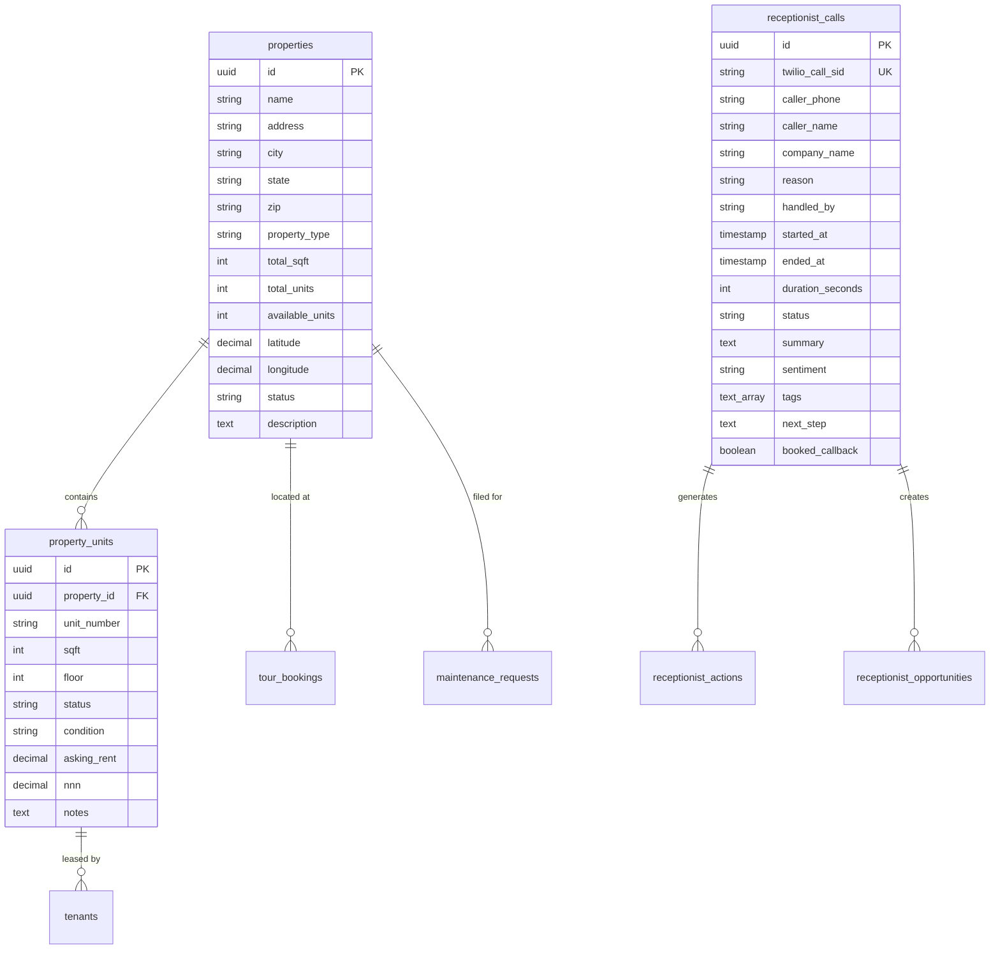

# 🏢 Zara Spaces — Autonomous Commercial Leasing AI Platform

[](https://nextjs.org/)
[](https://ai.google.dev/)
[](https://www.twilio.com/)
[](https://supabase.com/)
[](https://tailwindcss.com/)
[](https://portal.zaraspaces.com)

**Zara Spaces** is an enterprise-grade, autonomous commercial real estate leasing automation platform. It fuses a **real-time speech-to-speech AI voice leasing agent (Genesis)** with an interactive **Next.js 15 commercial property operations portal and CRM**.

This repository contains the complete source code, voice AI engines, database migrations, AI training files, Obsidian documentation vault, and production deployment automation.

---

## 📑 Table of Contents

1. [System Overview & Architecture](#-system-overview--architecture)
2. [What the Platform Does (Complete Capabilities)](#-what-the-platform-does-complete-capabilities)
   * [1. Autonomous AI Voice Leasing Agent](#1-autonomous-ai-voice-leasing-agent-genesis)
   * [2. Commercial Operations & Leasing Dashboard](#2-commercial-operations--leasing-dashboard)
   * [3. Lead Capture & Autonomous CRM Pipeline](#3-lead-capture--autonomous-crm-pipeline)
   * [4. Maintenance Triage & Tenant Operations](#4-maintenance-triage--tenant-operations)
   * [5. Real-Time Analytics & Reporting Suite](#5-real-time-analytics--reporting-suite)
   * [6. Administration & Team Onboarding](#6-administration--team-onboarding)
3. [Under the Hood: How It Works](#-under-the-hood-how-it-works)
   * [The Real-Time Voice Audio Pipeline](#the-real-time-voice-audio-pipeline)
   * [The Knowledge & Context Injection Engine](#the-knowledge--context-injection-engine)
   * [The Post-Call Processing Pipeline](#the-post-call-processing-pipeline)
   * [Database Schema & Data Architecture](#database-schema--data-architecture)
4. [Commercial Portfolio Managed by the AI](#-commercial-portfolio-managed-by-the-ai)
5. [Repository Directory Structure](#-repository-directory-structure)
6. [Complete Setup & Local Running Guide](#-complete-setup--local-running-guide)
7. [Production Deployment Guide (VPS / Cloudflare / Nginx)](#-production-deployment-guide)
8. [Environment Variables Reference](#-environment-variables-reference)
9. [Obsidian Vault Documentation](#-obsidian-vault-documentation)

---

## 🏛️ System Overview & Architecture

```
                            PROSPECT INBOUND CALL
                                      │
                                      ▼
                        ┌───────────────────────────┐
                        │ Twilio Programmable Voice │
                        │    (+1 325-221-0762)      │
                        │    (8kHz µ-law audio)     │
                        └─────────────┬─────────────┘
                                      │
                    WebSocket Stream (/media-stream)
                                      │
                                      ▼
                        ┌───────────────────────────┐
                        │    Fastify Audio Gateway  │ Port 5050
                        │  (Audio transcoding / IO) │ (Main/index.js)
                        └─────────────┬─────────────┘
                                      │
                         Bidirectional PCM Audio
                         (16kHz up / 24kHz down)
                                      │
                                      ▼
                        ┌───────────────────────────┐
                        │   Google Gemini Live API  │ S2S Native
                        │ gemini-3.1-flash-live-prv │ Enceladus Voice
                        └─────────────┬─────────────┘
                                      │
                         Post-Call Structured Event
                                      │
                                      ▼
                        ┌───────────────────────────┐
                        │   Dashboard Writer Engine │
                        │   • JSON call analysis    │
                        │   • Lead score & opps     │
                        │   • Follow-up task gen    │
                        │   • Email & SMS dispatch  │
                        └─────────────┬─────────────┘
                                      │
                                      ▼
                        ┌───────────────────────────┐
                        │  Supabase Cloud Database  │ PostgreSQL
                        │  Auth / Tables / Realtime │ vyplzkwifcfjbmhddlsb
                        └─────────────┬─────────────┘
                                      │
                                      ▼
                        ┌───────────────────────────┐
                        │    Next.js 15 Dashboard   │ Port 3000
                        │  (portal.zaraspaces.com)  │ App Router
                        └───────────────────────────┘
```

---

## ⚡ What the Platform Does (Complete Capabilities)

### 1. Autonomous AI Voice Leasing Agent ("Genesis")
* **Inbound Call Answering 24/7/365:** Instantly answers prospective tenant phone calls on `+1 (325) 221-0762` with zero hold time.
* **Direct Speech-to-Speech:** Powered by Google's native multimodal Gemini Live engine. Eliminates traditional STT-LLM-TTS latency daisy chains for ultra-low latency, natural conversational cadence.
* **Intelligent Barge-in:** Prospects can interrupt the assistant at any time; the system detects speech-started events, clears the Twilio output audio buffer, and dynamically pivots.
* **Prospect Qualification:** Autonomously qualifies leads on the call:
  * Desired business concept / use (retail, office, restaurant, warehouse, salon, medical).
  * Square footage requirements.
  * Target move-in timeframe.
  * Budget and NNN rate expectations.
* **Portfolio Matching:** Matches prospect criteria against all 13 properties, active vacancies, and specific suite numbers in real time.
* **Automated Tour Scheduling:** Checks agent availability and books physical tour walk-throughs directly during the phone call.
* **Instant SMS Follow-up:** Automatically fires a text message to the caller's mobile device during or immediately after the call with direct links to view available suites, property flyers, and application forms.
* **Executive Email Summaries:** Formats and dispatches structured post-call briefing emails to `leasing@zaraspaces.com` with full caller details, sentiment, urgency, and recommended next steps.

---

### 2. Commercial Operations & Leasing Dashboard
* **Portfolio Map View:** Interactive Leaflet map visualizing all 13 commercial centers across Greater Houston with color-coded markers for occupancy health.
* **Interactive SVG Floor Plans:** Visual layout of building suites with live occupancy indicators:
  * 🟢 Available (with asking rent & NNN)
  * 🔴 Leased
  * 🟡 Under Negotiation / Reserved
  * ⚪ Under Renovation / White Box
* **Inbound Calls Hub:** Searchable, filterable audit log of every call handled by the AI voice system:
  * Full synchronized audio playback.
  * Complete word-for-word transcript.
  * AI-generated call synopsis.
  * Sentiment classification (`Warm`, `Neutral`, `Urgent`).
  * Action tags and next-step recommendations.

---

### 3. Lead Capture & Autonomous CRM Pipeline
* **Auto-Generated Leads:** Every qualifying call creates a candidate lead record in `receptionist_opportunities` with zero manual data entry.
* **Kanban Pipeline Board:** Drag-and-drop opportunity tracking across stages:
  * `New Lead` ➡️ `Qualified` ➡️ `Tour Scheduled` ➡️ `Proposal Sent` ➡️ `Negotiation` ➡️ `Lease Executed` / `Closed Lost`.
* **Lead Scoring & Deal Valuation:** Automatically estimates annual contract lease value based on required square footage and asking NNN rent.
* **Automated Task Generation:** Creates actionable follow-up items in `receptionist_actions` (e.g., *"Send LOI for Suite B-3"*, *"Call back regarding grease trap specs"*) with assigned owners and due dates.

---

### 4. Maintenance Triage & Tenant Operations
* **AI Emergency Detection:** Analyzes tenant calls for critical hazards (gas leaks, active flooding, electrical fires, sewage backups) vs. routine tickets (lightbulb replacement, AC check).
* **Work Order Generation:** Auto-populates maintenance tickets with unit number, urgency level, category, and vendor assignment notes.
* **Tenant Directory:** Centralized registry of current tenants, suite assignments, lease start/expiration dates, and emergency contacts.

---

### 5. Real-Time Analytics & Reporting Suite
* **Telephony AI Metrics:** Total calls, answer rate (100%), average call duration, sentiment distribution, and peak hourly call volume charts.
* **Portfolio & Occupancy Analytics:** Total portfolio square footage (350,000+ SF), occupied vs. vacant SF, gross potential rent, and individual property occupancy rates.
* **Leasing Conversion Metrics:** Tour booking conversion ratios, lead source breakdowns, and pipeline velocity.
* **Maintenance Ops Insights:** Open vs. resolved tickets, emergency response turnaround times, and recurring issue tracking.

---

### 6. Administration & Team Onboarding
* **Role-Based Access Control (RBAC):** Restricts administrative functions and the `/settings` panel strictly to verified administrators (`admin@zaraspaces.com`).
* **Team Management & Onboarding:** Invite internal leasing agents, property managers, and maintenance personnel via email with custom roles (`Admin`, `Leasing Agent`, `Property Manager`, `Viewer`).
* **AI Configuration Studio:** Change the voice persona, adjust greeting prompts, modify business hours, and update SMS delivery templates in real time.

---

## 🛠️ Under the Hood: How It Works

### The Real-Time Voice Audio Pipeline

```
1. Caller Dials (+1 325-221-0762)
        │
2. Twilio Voice connects call to:
   POST https://voice.zaraspaces.com/incoming-call
        │
3. Voice Gateway returns TwiML with <Connect><Stream>:
   wss://voice.zaraspaces.com/media-stream
        │
4. Media Stream sends raw 8kHz G.711 µ-law audio chunks
        │
5. Gateway Worker (index.js):
   • Decodes µ-law audio to 8kHz linear PCM
   • Upsamples 8kHz PCM to 16kHz linear PCM
   • Forwards 16kHz PCM chunks to Google Gemini Live API
        │
6. Google Gemini Live evaluates audio against domain knowledge
   • Generates 24kHz linear PCM synthesized speech
        │
7. Gateway Worker:
   • Downsamples 24kHz PCM to 8kHz linear PCM
   • Encodes 8kHz PCM to G.711 µ-law
   • Sends base64-encoded media payload back via WebSocket to Twilio
        │
8. Caller hears crystal-clear, zero-lag voice response
```

### The Knowledge & Context Injection Engine
When `index.js` initializes, it compiles all Markdown files in `Main/knowledge/` into the Gemini system instruction prompt:
* **`zara_spaces_properties.md`:** Comprehensive specs for all 13 properties, suite numbers, dimensions, ceiling heights, drive-thru capabilities, grease trap availability, and parking ratios.
* **`zara_spaces_lease_terms.md`:** Lease structures (NNN, Gross, Modified), standard term lengths (3–5 years), security deposit rules, personal guarantee requirements, and permitted uses.
* **`zara_spaces_qualification.md`:** Exact multi-step qualification script to guide prospects from inquiry to tour booking.

### The Post-Call Processing Pipeline
When the WebSocket connection closes:
1. Fastify captures the raw call transcript and duration.
2. `services/dashboard-writer.js` calls Gemini with a strict JSON schema prompt to extract:
   * Caller name, company name, contact phone.
   * Inquiry intent, requested property, requested suite.
   * Deal timeline, budget, and qualification score.
   * Executive summary, sentiment tag, and follow-up actions.
3. The writer executes atomic multi-table inserts into Supabase:
   * Record to `receptionist_calls`
   * Lead opportunity to `receptionist_opportunities`
   * Action items to `receptionist_actions`
4. If a valid mobile number is present, `services/twilio-sms.js` triggers an instant SMS with the leasing brochure link.
5. `services/email-service.js` compiles an HTML email digest and dispatches it via SMTP to `leasing@zaraspaces.com`.

### Database Schema & Data Architecture



---

## 🏙️ Commercial Portfolio Managed by the AI

The platform actively manages and routes leasing inquiries for 13 commercial real estate developments across Houston and surrounding markets:

| Property Name | Address | Type | Total SF | Highlights |
|:---|:---|:---|:---|:---|
| **Stafford Oaks Business Park** | 212 Brand Lane, Stafford, TX 77477 | Mixed Use / Flex | 44,408 SF | 7 Buildings, 29 Suites (A-1 to G-2), grade-level roll-up doors, high power, office/warehouse flex |
| **NASA Shopping Center** | 1020 W NASA Pkwy, Webster, TX 77598 | Shopping Center | 48,000 SF | Across from NASA Space Center, prime retail/medical suites |
| **Parkview East Shopping Center** | 16230 West Bellfort, Sugar Land, TX 77498 | Retail Strip | 32,500 SF | High-traffic intersection, anchor tenants, restaurant ready |
| **Shops at Harlem** | Harlem Rd & Grand Pkwy, Richmond, TX | Retail Strip | 24,000 SF | Affluent suburban growth corridor, end-cap with drive-thru |
| **La Sendera at Barker Cypress** | Barker Cypress & Tuckerton, Cypress, TX | Retail Strip | 28,000 SF | High-density residential submarket, modern white-box suites |
| **17313 North Freeway** | 17313 North Fwy (I-45), Houston, TX 77090 | Commercial / Retail | 36,000 SF | Massive Interstate 45 frontage, highway pylon signage |
| **1700 FM 1960** | 1700 FM 1960, Houston, TX 77090 | Retail Strip | 22,000 SF | Dense commercial arterial corridor, signalized intersection |
| **7518-7520 Lawndale St** | 7518 Lawndale St, Houston, TX 77012 | Urban Retail | 18,500 SF | East End Houston market, neighborhood retail & service |
| **Riverstone Commercial Center** | 18721 University Blvd, Sugar Land, TX 77479 | Mixed Retail / Office | 30,000 SF | Master-planned Riverstone community, high-income demographic |
| **Town Park Plaza** | Town Park Dr, Houston, TX 77036 | Strip Center | 26,000 SF | Westchase district adjacency, medical & service commercial |
| **At Home Portfolio Center** | Greater Houston Metro Area | Anchor Retail | 52,000 SF | Large format junior box spaces |
| **West Bellfort Center** | West Bellfort Ave, Houston, TX | Commercial Strip | 20,000 SF | Neighborhood retail hub |
| **Southwest Freeway Complex** | US-59 / I-69 Corridor, Stafford, TX | Flex Commercial | 34,000 SF | Freeway visibility, flexible showroom/storage spaces |

---

## 💻 Complete Setup & Local Running Guide

### 1. System Requirements
* Windows 10/11, macOS, or Linux (Ubuntu 22.04 LTS recommended)
* Node.js v18.20.4 or v20.x+
* npm v9.x or v10.x+

### 2. Clone the Repository
```bash
git clone https://github.com/automation170/ZaraSpaces.git
cd ZaraSpaces
```

### 3. Configure Local Secrets

#### Create `Main/.env`:
```bash
cp Main/.env.example Main/.env
```
Fill in your API credentials:
* `GEMINI_API_KEY`: Get from [Google AI Studio](https://aistudio.google.com).
* `SUPABASE_URL` & `SUPABASE_SERVICE_ROLE_KEY`: Get from your [Supabase Project Settings](https://supabase.com/dashboard).
* `TWILIO_ACCOUNT_SID` & `TWILIO_AUTH_TOKEN`: Get from [Twilio Console](https://console.twilio.com).
* `SMTP_USER` & `SMTP_PASS`: Gmail App Password for post-call email digests.

#### Create `Main/Dashboard/Mobilelink Dashboard/.env.local`:
```bash
NEXT_PUBLIC_SUPABASE_URL=https://vyplzkwifcfjbmhddlsb.supabase.co
NEXT_PUBLIC_SUPABASE_PUBLISHABLE_KEY=your_supabase_publishable_key
SUPABASE_URL=https://vyplzkwifcfjbmhddlsb.supabase.co
SUPABASE_SERVICE_ROLE_KEY=your_supabase_service_role_key
```

### 4. Install Dependencies
```bash
# Install backend dependencies
cd Main
npm install

# Install dashboard dependencies
cd "Dashboard/Mobilelink Dashboard"
npm install
```

### 5. Launch Locally

#### Option A: One-Click Script
* **PowerShell:** Run `.\start-all.ps1` from the root directory.
* **Command Prompt:** Double-click `start-all.bat`.

#### Option B: Separate Terminals
```bash
# Terminal 1 — Voice AI Gateway (Port 5050)
cd Main
node index.js

# Terminal 2 — Next.js Dashboard (Port 1997 / 3000)
cd "Main/Dashboard/Mobilelink Dashboard"
npm run dev
```

Visit the dashboard locally at: **`http://localhost:1997`**

---

## 🚀 Production Deployment Guide

The app is deployed in production under:
* **Web Dashboard:** `https://portal.zaraspaces.com`
* **Voice AI Gateway:** `https://voice.zaraspaces.com`

For the step-by-step VPS configuration runbook, see:
👉 **[`Main/DEPLOYMENT_GUIDE.md`](Main/DEPLOYMENT_GUIDE.md)**

### Production Architecture Summary:
1. **PM2 Process Daemon:** Runs both services in cluster/fork mode with automatic restart on boot:
   * `voice-ai` (`Main/index.js`) on port `5050`
   * `dashboard` (`npm run start`) on port `3000`
2. **Nginx Reverse Proxy:** Terminates SSL and forwards traffic:
   * `portal.zaraspaces.com` ➡️ `http://127.0.0.1:3000`
   * `voice.zaraspaces.com` ➡️ `http://127.0.0.1:5050` (with WebSocket upgrade headers)
3. **Cloudflare:** Provides DDoS mitigation, edge SSL certificates (Full mode), and DNS management.
4. **Twilio Voice Webhook:** Set to `https://voice.zaraspaces.com/incoming-call` (HTTP POST).

---

## 🔑 Environment Variables Reference

| Variable | Scope | Purpose |
|:---|:---|:---|
| `GEMINI_API_KEY` | Backend (`Main/.env`) | Google AI Gemini Live API key for speech-to-speech AI |
| `GEMINI_LIVE_MODEL` | Backend (`Main/.env`) | Defaults to `gemini-3.1-flash-live-preview` |
| `GEMINI_LIVE_VOICE` | Backend (`Main/.env`) | Voice persona name (e.g., `Enceladus`) |
| `SUPABASE_URL` | Backend & Dashboard | Supabase project endpoint |
| `SUPABASE_SERVICE_ROLE_KEY` | Backend & Dashboard | Bypasses RLS for automated voice worker DB writes |
| `NEXT_PUBLIC_SUPABASE_URL` | Dashboard (`.env.local`) | Client-side Supabase URL |
| `NEXT_PUBLIC_SUPABASE_PUBLISHABLE_KEY` | Dashboard (`.env.local`) | Client-side Supabase public anon key |
| `DATABASE_URL` | Backend (`Main/.env`) | Direct PostgreSQL connection string |
| `TWILIO_ACCOUNT_SID` | Backend (`Main/.env`) | Twilio account identifier |
| `TWILIO_AUTH_TOKEN` | Backend (`Main/.env`) | Twilio API authentication token |
| `TWILIO_SMS_FROM` | Backend (`Main/.env`) | Outbound SMS phone number (`+13252210762`) |
| `VOICE_SERVER_URL` | Backend (`Main/.env`) | Production domain base (`https://voice.zaraspaces.com`) |
| `SUMMARY_EMAIL_TO` | Backend (`Main/.env`) | Recipient for call alerts (`leasing@zaraspaces.com`) |
| `SMTP_HOST` | Backend (`Main/.env`) | Mail server host (`smtp.gmail.com`) |
| `SMTP_PORT` | Backend (`Main/.env`) | Mail server port (`465`) |
| `SMTP_USER` | Backend (`Main/.env`) | Sender email account address |
| `SMTP_PASS` | Backend (`Main/.env`) | App password for SMTP authentication |

---

## 📚 Obsidian Vault Documentation

This repository contains a dedicated knowledge vault in the [`Vault/`](Vault/) directory.
To explore it:
1. Open the **Obsidian** app.
2. Select **Open folder as vault**.
3. Choose the `Vault` folder in this repository.

### Included Vault Sections:
* **`Home.md`**: Main navigation index.
* **`01 — Architecture/`**: Deep-dive technical blueprints, audio transcoders, and WebSocket lifecycles.
* **`02 — Deployment/`**: Complete VPS setup, firewall, PM2, and Nginx reverse proxy configs.
* **`03 — Operations/`**: Day-to-day operations manual, admin credentials, and phone maintenance.
* **`04 — Properties/`**: Complete suite catalogs, building specs, and tenant rosters.
* **`05 — Database/`**: Full schema definitions, SQL scripts, and ER diagrams.
* **`06 — Credentials/`**: Environment variable inventory and safe setup guides.

---

## 👥 Default Administrative Access

* **Portal URL:** `https://portal.zaraspaces.com` (Production) / `http://localhost:1997` (Development)
* **Default Admin Account:** `admin@zaraspaces.com`
* **Default Admin Password:** `ZaraAdmin@2026!`

---

## 📄 License & Attribution

Proprietary commercial software built for **Zara Spaces**.
Unauthorized copying, modification, distribution, or public hosting of this code without explicit written consent is strictly prohibited.

© 2026 Zara Spaces. All rights reserved.
